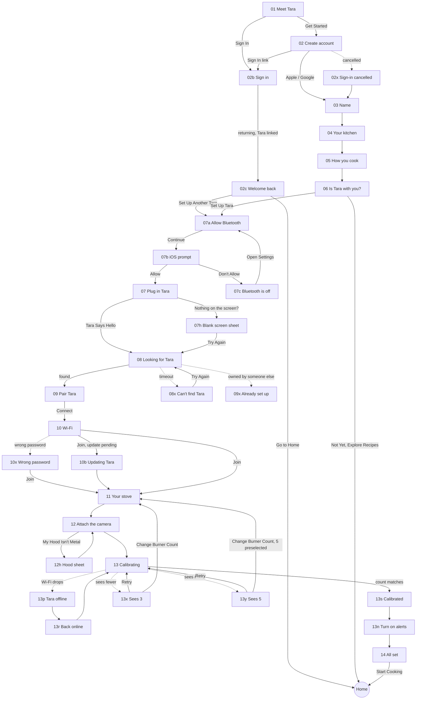

# Tara onboarding: PWA prototype handoff

**What this is:** a clickable PWA of the Tara companion app onboarding, so Ajay can test the flow on an iPhone and design motion in it.
**What this is not:** production. Sign-in, Bluetooth, Wi-Fi, notifications and the Tara device are all simulated. Nothing talks to a backend.

- Figma file: `jxCb3e8Ss6GLRHv6mEveav` (Cravv Beta App UI Final), page **NEW**
- Section: **Onboarding · Final** (`2525:2469`)
- Components: Section 5 (`2608:10940`), which holds Components · Onboarding, Icons and the Colour map
- Tokens: `tokens.css` (exported from the Figma variables, same names as their WEB code syntax)

Read any screen with the Figma MCP `get_design_context` using the node IDs below. Treat the frames as the visual source of truth and this doc as the behaviour source of truth.

---

## 1. Ground rules

1. **Don't draw the status bar, Dynamic Island or home indicator.** They're mockup furniture in the frames. Use `viewport-fit=cover` and respect `env(safe-area-inset-*)`. Frames are 402 × 874 (iPhone 16 Pro Max); lay out fluidly from 375 to 440 wide.
2. **Type:** `var(--cravv-font)` (the system stack renders SF Pro on iPhone). Sizes follow the iOS ramp: Large Title 34 Bold, Title 2 22 Bold, Headline 17 Semibold, Body 17, Subheadline 15, Footnote 13, Caption 12 / 11.
3. **Dark only.** The screen background is a vertical gradient: `#1C1C1F` → `#141416` → `#0E0E10`.
4. **Colours come from `tokens.css`. Don't eyedrop.**
   - Copper (`--cravv-copper-500`) is only for progress bars and text links.
   - Selected options use their own `option/*` tokens. An icon that isn't chosen is `--cravv-option-icon-off`.
5. **Corners use smooth (squircle) curves** in Figma. On the web, plain `border-radius` is fine.
6. **Touch targets** are at least 44 px. Primary buttons are white pills (52 px tall) with a dark label. Secondary actions are text buttons.
7. **Single-page app with a state machine.** One route per screen id below, so any screen can be deep-linked for motion work (for example, `/#/13`).
8. **Persist prototype state** in `localStorage`, wrapped in try/catch. A "Reset prototype" button in the debug menu clears it.

---

## 2. Flow map



Solid arrows are the happy path. Dotted arrows are branches, triggered either by the simulation script (section 4) or by the debug menu (section 5).

---

## 3. Screens

| ID | Name | Figma node | Behaviour |
|---|---|---|---|
| 01 | Meet Tara | `2525:2470` | Get Started → 02. Sign In → 02b. |
| 02 | Create account | `2525:2491` | Bottom sheet over the photo. Apple or Google: fake a 1.2 s system sheet, then → 03. "Already have an account? Sign In" swaps the sheet to 02b with no route change. |
| 02x | Sign-in cancelled | `2628:4676` | The same sheet with an info notice on top. Buttons retry. |
| 02b | Sign in | `2525:2509` | The same sheet, returning-user copy. Apple or Google → 02c. "New to Tara? Create Account" → 02. |
| 02c | Welcome back | `2526:2670` | Restored setup summary. Go to Home ends onboarding. Set Up Another Tara → 07a. |
| 03 | Name | `2525:2527` | Name field prefilled "Priya" ("From Apple ID"). The play button reads the pronunciation aloud (use `speechSynthesis`). Continue disabled while the name is empty. |
| 04 | Your kitchen | `2525:2595` | **Diet:** multi-select; Everything clears the others. **Allergies:** multi-select (Avoid state, struck icon); "None" clears them. **Cuisines:** multi-select. Each chip's on colour comes from its option token. |
| 05 | How you cook | `2525:2745` | Cooking for: stepper from 1 to 8, default 2. Units: segmented US / Metric, default US. Skill: single-select tile (New / Comfortable / Confident), default Comfortable. |
| 06 | Is Tara with you? | `2525:2801` | Set Up Tara → 07a. Not Yet, Explore Recipes ends onboarding with `setupPending = true`. |
| 07a | Allow Bluetooth | `2626:4577` | Pre-permission. Continue → 07b. Not Now → 06. |
| 07b | iOS Bluetooth prompt | `2626:4660` | Simulated system alert: 270 px, centred, blurred. Allow → 07. Don't Allow → 07c. |
| 07c | Bluetooth is off | `2626:4697` | Open Settings: fake a 1 s leave and return, then → 07a. Back → 06. |
| 07 | Plug in Tara | `2532:2804` | Step strip 01–03. "Tara Says Hello" → 08. "Nothing on the screen?" → 07h. |
| 07h | Blank screen sheet | `2628:4892` | Sheet with a three-item checklist. Try Again → 08. Get Help just closes the sheet. |
| 08 | Looking for Tara | `2532:2850` | Pulsing rings around the drawing. Auto → 09 after 3 s. Cancel → 07. |
| 08x | Can't find Tara | `2532:2985` | Sheet with a checklist. Try Again → 08. |
| 09 | Pair Tara | `2525:2862` | Accessory card: "Tara's screen shows 4F2". Connect → 10. The close button → 07. |
| 09x | Already set up | `2626:4870` | Sheet. How to Reset Tara just closes the sheet. Set Up a Different Tara → 07. |
| 10 | Wi-Fi | `2533:2804` | Home WiFi preselected. Password field with an eye toggle. Join Network: 1.5 s spinner on the button, then → 11, or → 10b if `updatePending`. Any password works unless the wrong-password debug option is on. |
| 10x | Wrong password | `2533:2925` | Red outline plus a red message. Editing the field clears the error. |
| 10b | Updating Tara | `2626:4975` | Copper ring and bar fill from 0 to 100% over 8 s, then → 11. |
| 11 | Your stove | `2525:2910` | "Tara is online" pill. Stove type is single-select (default Electric coil). **Burners: segmented 1–5, default 4.** The stove preview card swaps its plan drawing to match the count; use the Stove preview component variants (Burners = 1–5) in Section 5. |
| 12 | Attach the camera | `2525:2955` | Continue → 13. "My Hood Isn't Metal" → 12h. |
| 12h | Hood sheet | `2628:4821` | Three numbered steps. Got It closes the sheet. |
| 13 | Calibrating | `2537:2804` | Live view (use the frame's image) with a "Tara sees n burners…" chip that counts up. The progress bar fills over 6 s. Outcome comes from the debug setting: match → 13s, fewer → 13x, more → 13y. Cancel → 12. |
| 13p | Tara offline | `2628:4717` | Amber pill; live view dimmed with "Tara lost Wi-Fi"; bar greyed. Auto → 13r after 3 s. |
| 13r | Back online | `2628:4770` | Green pill fades after 2 s, then calibration resumes from where it stopped. |
| 13s | Calibrated | `2537:2904` | Result card "4 of 4 burners · Matched". Continue → 13n. |
| 13x | Sees 3 of 4 | `2537:3002` | Retry → 13. Change Burner Count → 11. |
| 13y | Sees 5, picked 4 | `2541:2813` | Retry → 13. Change Burner Count → 11 with 5 preselected. |
| 13n | Turn on alerts | `2626:4780` | Pre-permission with a sample alert. Turn On Alerts: show a simulated iOS alert (same pattern as 07b), then → 14. Not Now → 14. |
| 14 | All set | `2525:3038` | Summary card. Start Cooking ends onboarding. Not Now ends onboarding. |
| 14b | All set, first cook (variant) | `2539:2801` | Alternative ending with a suggested first recipe. Choose 14 or 14b in the debug menu. |

**Step bars**
- Personalise screens (03–05) use a 3-segment bar.
- Connect screens (07–13) use a 4-segment bar: Connect · Wi-Fi · Stove · Camera.
- Segments are copper when done or current, and 15% white otherwise.

---

## 4. Simulation script (defaults)

| Moment | Default |
|---|---|
| Fake Apple / Google sheet | 1.2 s |
| 08 search → found | 3 s |
| 08 timeout → 08x (if "Can't find" is on) | 8 s |
| 10 join | 1.5 s |
| 10b update | 8 s |
| 13 calibration | 6 s; count chip ticks 1 → 4 |
| 13p → 13r | 3 s |
| 13r pill fade | 2 s |

Fake data: name **Priya**, pairing code **4F2**, network **Home WiFi**, other networks **TP-Link_5G** (locked) and **Netgear_Guest**, stove **Electric coil**, **4** burners.

---

## 5. Debug menu

Open it with a three-finger tap anywhere, or `?debug=1`. It's a bottom sheet with:

- **Jump to screen** (list of every ID above)
- **Sign-in:** succeeds / cancelled (02x)
- **Bluetooth permission:** allow / deny (07c)
- **Find Tara:** found / can't find (08x) / already set up (09x)
- **Wi-Fi:** joins / wrong password once (10x)
- **Update pending:** on / off (10b)
- **Calibration result:** match / fewer (13x) / more (13y)
- **Drop Wi-Fi during calibration:** on / off (13p → 13r)
- **Ending:** 14 / 14b
- **Speed:** 0.5× / 1× / 2× (scales every timer in section 4)
- **Slow animations ×5** (for motion review)
- **Reset prototype**

---

## 6. State captured

```ts
type Onboarding = {
  name: string;              // "Priya"
  diet: string[];            // ["vegetarian"]; "everything" clears the others
  allergies: string[];       // ["peanuts"]; [] means none
  cuisines: string[];        // ["italian","mexican","indian"]
  cookingFor: number;        // 2
  units: "us" | "metric";    // "us"
  skill: "new" | "comfortable" | "confident";
  stoveType: "gas" | "induction" | "electric-coil" | "infrared";
  burners: 1 | 2 | 3 | 4 | 5;
  wifi: string;              // "Home WiFi"
  alerts: boolean;
  setupPending: boolean;     // true if they chose Not Yet on 06
  step: string;              // last screen id, to resume
};
```

Leaving mid-setup and reopening resumes at `step`.

---

## 7. Motion moments (where to spend motion effort)

These are placeholders. Ajay designs the final motion. Default to an iOS-like spring (about 0.35 s, no visible overshoot) and honour `prefers-reduced-motion` with a cross-fade.

1. **Push and pop between screens:** horizontal slide with a parallax on the outgoing screen. Back swipe from the left edge.
2. **Sheets (02/02b, 07h, 08x, 09x, 12h):** rise from the bottom with the dim fading in. Swapping 02 ↔ 02b morphs the sheet height in place.
3. **Step bar:** the next segment fills left to right when a step is completed.
4. **Chips and tiles:** colour fill blooms from the touch point. The icon goes grey → white.
5. **08 search:** rings pulse outwards. On found, the rings collapse into the drawing and the 09 card rises.
6. **10 join → 11:** the button spinner resolves into a check, then the green "Tara is online" pill slides in on 11.
7. **11 burner count:** the stove plan morphs between layouts (burners move and scale) as the segment changes.
8. **13 calibration:** the count chip ticks up; the copper brackets breathe. The result card reveals with a small settle.
9. **10b update:** the ring fills; at 100% it becomes a check.
10. **13p offline:** the live view dims; the amber pill drops in. On reconnect, the pill turns green, then fades.
11. **14 All set:** the summary rows stagger in. This is the one moment that can be celebratory.

---

## 8. Assets

Export the photos and drawings straight from the Figma frames:
- 01 and 02 hero photos
- device drawings (07, 08, 09)
- camera photo (12)
- live view image (13)
- food photos (14b)

Icons are the `Icon / *` components in Section 5. Export them as SVG and colour them with tokens via `currentColor`.

## 9. Out of scope

Real auth, Bluetooth, Wi-Fi, notifications, analytics, Home and the other tabs beyond a placeholder "Home" screen that says onboarding is done, and the Nutrition setup flow (separate section).
