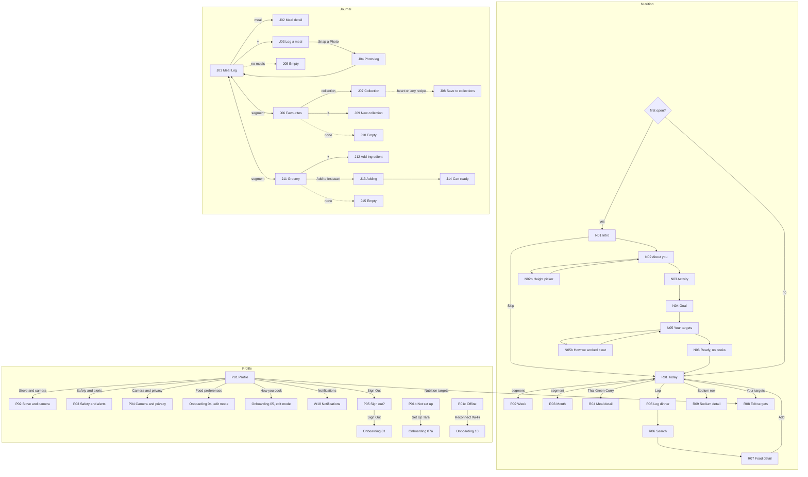

# Tara app: Nutrition, Journal and Profile tabs (PWA prototype handoff)

**What this is:** the three tab roots and their flows for the Tara companion app PWA, so Ajay can test them on an iPhone and design motion. It extends the onboarding PWA (`ONBOARDING_HANDOFF.md`): same codebase, same rules, same `tokens.css`.
**What this is not:** production. Auth, Tara, the camera, Instacart and food data are all simulated. Nothing talks to a backend.

- Figma file: `jxCb3e8Ss6GLRHv6mEveav` (Cravv Beta App UI Final), page **NEW**
- Components: **Section 5** (`2608:10940`) → **Components · Tabs** (new, right of Components · Onboarding), plus the onboarding components and the Colour map
- Tokens: `tokens.css` (regenerated today; now includes `option-tab-*`, `option-nutrient-*` and `option-feedback-*`)

Read any screen with the Figma MCP `get_design_context` using the node IDs below. Treat the frames as the visual source of truth and this doc as the behaviour source of truth.

---

## 0. What went wrong last time (read first)

The first build used the frames in **Home · Explore v2 + tabs** (`2568:3978`): `Nutrition · new nav`, `Journal · new nav` and `Profile · new nav`. Those were early tab roots and are **superseded**. They now sit in **Superseded · old tab roots (do not build)** (`2669:5951`), and their old slots hold "Moved" cards. The **App structure v2** section (`2552:2970`) is superseded for the same reason.

| Tab | Wrong (old) | Build from |
|---|---|---|
| Nutrition | Weekly "4 cooks" card, "By meal" list | **R01 · Nutrition · Today** `2634:4767`: date, Today/Week/Month, macro ring with kcal left, watched nutrients, today's meals with a Log row for dinner, a tip, targets |
| Journal | Cooked / Plan tabs, "Coming up", grocery as a single row | **J01 · Meal Log** `2662:5711`: Meal Log / Favourites / Grocery, diary by day with day totals, + button |
| Profile | Copper avatar, flat settings list | **P01 · Profile** `2670:5951`: account, Tara card with status, Tara settings, You, App, Sign Out |

Rules the old build also broke:
- **Copper is only for progress and text links.** Never an avatar, icon or reading.
- **Icons are filled.** Grey (`--cravv-option-icon-off`) for navigation or not chosen; coloured only when chosen or true.
- The tab bar colours come from `--cravv-option-tab-<tab>-base`. Home orange, Nutrition green, Journal blue, Profile purple.

---

## 1. Ground rules

Everything in section 1 of `ONBOARDING_HANDOFF.md` applies (no drawn status bar, SF Pro via `--cravv-font`, dark gradient background, tokens only, 44 px targets, one route per screen, `localStorage` in try/catch). In addition:

1. **Tab shell.** Four tabs: Home · Nutrition · Journal · Profile. The tab bar is a floating pill 20 px from the sides, sitting above the home indicator. Each tab keeps its own navigation stack and scroll position when you switch away.
2. **Tab roots use a Large Title** (34 Bold) that collapses into an inline title on scroll. Pushed screens use the round glass back button at top left (see R09 `2636:5201`) and a Large Title below it.
3. **Cooking mini bar.** While a cook or a watch is running, the mini bar sits 6 px above the tab bar on every tab. Tapping it opens the live session (a placeholder screen in this PWA). Toggle it from the debug menu.
4. **Scroll fade.** A gradient behind the tab bar fades content out (`Scroll fade` layer, 150 px).
5. **Home** is not part of this pass. Keep the placeholder Home screen, or build `Home v2` (`2568:4136`) if time allows.

---

## 2. Flow map



Solid arrows are the happy path. Dotted arrows are states reached through data or the debug menu.

---

## 3. Screens

### Nutrition (section `2598:4095`)

| ID | Name | Node | Behaviour |
|---|---|---|---|
| N01 | First open | `2601:3864` | Shown only on the first visit to the tab (`nutritionSetup = false`). Set Up → N02. Skip → R01 with standard 2,000 kcal targets. |
| N02 | About you | `2601:4009` | Age, sex, height, weight. The pregnancy row appears only when sex is Female. Height opens N02b. |
| N02b | Height picker | `2601:4219` | Sheet with a ft/in wheel (US units). Done writes the value back. |
| N03 | Activity | `2601:4302` | Single choice, outlined cards (they need a sentence each). |
| N04 | Goal | `2601:4503` | 2×2 Choice tiles, plus "Anything to watch?" chips (multi-select; these become the R01 watched nutrients). |
| N05 | Your targets | `2604:3943` | 1,900 kcal; protein 85 g, carbs 250 g, fat 63 g; fiber ≥ 27 g, sodium < 2,300 mg. "How we worked it out" → N05b. |
| N05b | How we worked it out | `2604:4167` | Read-only explainer (Mifflin–St Jeor × activity). |
| N06 | Ready, no cooks | `2604:4274` | Empty R01. Sets `nutritionSetup = true`. |
| R01 | Today | `2634:4767` | Default view. Ring = kcal left, split by macro. "You're watching" lists N04's chips. Meals: Tara cooks show the photo and log themselves; others show a grey icon well. Dinner shows Log → R05. The tip's "See Recipe" opens a placeholder recipe. |
| R02 | Week | `2634:4983` | Last 7 days, not the calendar week. |
| R03 | Month | `2634:5161` | One ring per day: green within 10% of target, amber off target; a dot marks days cooked with Tara. |
| R04 | Meal · Thai Green Curry | `2635:4818` | Servings-eaten stepper updates kcal live. Leftovers kept. |
| R05 | Log dinner | `2635:5048` | Leftovers from Tara first, then recent foods, search, quick add. |
| R06 | Search food | `2635:5239` | Filter the fake food list as you type. |
| R07 | Food detail | `2636:4870` | Shows the effect on today's watched nutrients before you add. Add → R01, with the new row animating in. |
| R08 | Edit targets | `2636:4966` | For You (calculated) or Custom (editable). Save → back. |
| R09 | Sodium detail | `2636:5201` | 7-day bars against the limit, top sources, a lighter-version suggestion. |

### Journal (section `2662:5705`)

| ID | Name | Node | Behaviour |
|---|---|---|---|
| J01 | Meal Log | `2662:5711` | Segmented: Meal Log / Favourites / Grocery (one route each). Diary grouped by day, newest first, each day with its total. Day totals must match Nutrition. + → J03. |
| J02 | Meal · Thai Green Curry | `2662:5888` | Rating (tap the stars), a note ("Tara adjusts next time"), Cook Again. |
| J03 | Log a meal | `2662:6109` | Sheet: Snap a Photo, Search, Quick add, leftovers from Tara, recent. |
| J04 | Photo log | `2662:6273` | Fake 1.5 s "estimating", then an estimate with a portion stepper. Add → J01. |
| J05 | Meal Log · empty | `2662:6465` | Shown when there are no meals (debug). |
| J06 | Favourites | `2663:5786` | "All favourites" plus a collection grid (mosaic covers; shared badge). |
| J07 | Collection | `2663:5941` | Pick Tonight, Shop All (adds every ingredient to Grocery → J11). Long-press and drag to reorder. |
| J08 | Save to collections | `2663:6163` | Sheet. Multi-select collections with checkmarks. |
| J09 | New collection | `2663:6284` | Name field, name ideas, share with family toggle. |
| J10 | Favourites · empty | `2663:6480` | Debug state. |
| J11 | Grocery | `2664:5866` | Lists grouped by dish, with amounts. Tick items you already have. Add to Instacart → J13. |
| J12 | Add ingredient | `2664:6053` | Sheet with an amount and unit. |
| J13 | Adding to Instacart | `2664:6224` | Progress runs for 4 s and can be left in the background. Stop asks to confirm. |
| J14 | Cart ready | `2664:6424` | Result lists: not added, changed, added. "Open Instacart" is a fake link. |
| J15 | Grocery · empty | `2664:6630` | Debug state. |

### Profile (section `2670:5948`)

| ID | Name | Node | Behaviour |
|---|---|---|---|
| P01 | Profile | `2670:5951` | Tab root. Rows open the screens in the flow map. Food preferences and How you cook reuse onboarding 04 and 05 in **edit mode**: same screens, but with a back button instead of the step bar, and the button reads Save. |
| P01b | Tara not set up | `2671:5966` | Shown when `setupPending = true` (the user chose Not Yet on onboarding 06). Set Up Tara → onboarding 07a. |
| P01c | Tara offline | `2671:6159` | Amber pill. Alarms still run on Tara; voice and phone alerts pause. Reconnect Wi-Fi → onboarding 10. |
| P02 | Stove and camera | `2673:6061` | Type and Burners open onboarding 11 in edit mode; saving runs calibration (13) again. Recalibrate → 13. "How to attach the camera" → 12. Remove Tara → action sheet → P01b. |
| P03 | Safety and alerts | `2673:6172` | Info and Act now switches persist. Urgent is always on. Family member is shown Off with a placeholder (its consent flow isn't designed yet). |
| P04 | Camera and privacy | `2673:6279` | The "Tara is seeing" chip shows only while a cook or watch is live (debug). Switches persist. Delete Cooking Photos → action sheet → clears photos from the fake Meal Log. Pause camera: while on, the mini bar reads "Camera paused". |
| P05 | Sign out? | `2673:6377` | Action sheet over P01. Sign Out resets all prototype state and goes to onboarding 01. |

---

## 4. Components (Section 5 → Components · Tabs)

| Component | Node | Variants / properties |
|---|---|---|
| Tab bar | `2674:6167` | Active = Home, Nutrition, Journal, Profile |
| Cooking mini bar | `2674:6186` | Mode = Cooking, Watching |
| Settings row | `2674:6230` | Type = Navigation, Value, Two-line, Switch, Destructive. Props: Label, Separator, Icon |
| Switch | `2674:6233` | State = On, Off (`--cravv-toggle-on-fill`) |
| Meal row | `2674:6290` | Context = Nutrition, Journal × Type = Tara cook, Logged, Not logged |
| Day header | `2674:6293` | — |
| Nutrient row | `2675:6100` | Nutrient = Fiber, Sodium (any nutrient: swap the option token) |
| Macro ring card | `2675:6122` | — |
| Tip note | `2675:6130` | — |
| Targets row | `2675:6140` | — |
| Account card | `2675:6150` | — |
| Tara card | `2675:6269` | State = Online, Offline, Not set up |
| Action sheet | `2675:6280` | — |
| Rating | `2675:6349` | Value = 0–5 |
| Icons · Tabs | in `Icon grid · Tabs` | sliders, display, shield, eye, bell, help, target, chevron, cart, search, mic |
| Icons · Meal filter | in `Icon grid · Meal filter` | sunrise, sun, moon, filters, soup, pot |

Reused from onboarding: Status pill (`2611:4150`), Segmented control, Chip, Choice tile, Sheet header (`2612:4051`).

**Icon and colour states (who decides):** the token decides, not the developer.
- Navigation and settings icons: always `--cravv-option-icon-off`.
- Tab icons: always filled. Off = `--cravv-option-icon-off`, on = `--cravv-option-tab-<tab>-base`.
- Nutrient icons and bars: `--cravv-option-nutrient-<name>-base`. Over a limit, the status line turns `--cravv-status-warning`. The bar keeps its nutrient colour.
- Rating stars: on `#FFD60A`, off 25% white.
- Status: Online `--cravv-status-success`, Offline `--cravv-status-warning`.
- Destructive text: `--cravv-status-alert`. Red is never an option colour.
- Copper: progress fills and text links only ("See Recipe", "Recalibrate").

---

## 5. Fake data

One persona everywhere. Numbers must agree across tabs.

- **Priya Shah**, signed in with Apple (fake). Vegetarian, avoids peanuts. Cooking for 2, US units, Comfortable.
- **Tara "Kitchen"**: online on Home WiFi, Electric coil, 4 burners, calibrated 4 of 4.
- **Today: Tue 17 Nov 2026.** Targets: 1,900 kcal; protein 85 g, carbs 250 g, fat 63 g. Watching fiber (27 g) and sodium (2,300 mg).

| Day | Meals | Total |
|---|---|---|
| Tue 17 | Greek yogurt bowl 320 (breakfast, logged 8:10 AM) · Thai Green Curry 540 (lunch, cooked with Tara 1:10 PM, ★4) · Apple & cheddar 210 (snack, logged 3:45 PM) · dinner not logged | 1,070 |
| Mon 16 | Spaghetti Pomodoro 610 (leftovers) + others | 1,700 |
| Sun 15 | Spaghetti Pomodoro 610 (cooked with Tara, ★4) + others | 1,820 |
| Sat 14 | Cheese pizza 570 (logged, 2 slices) + others | 2,120 |

R01 shows 830 kcal left (1,900 − 1,070). Fiber is 15 / 27 g, sodium 1,090 / 2,300 mg, saturated fat 26 / 21 g (over, amber).

- **Grocery:** lists for Black Bean Tacos and Paneer Butter Masala (needs cream and cashews). Read the items from J11.
- **Favourites:** read the collections from J06.
- **Food photos:** export them from the frames.

---

## 6. State

```ts
type Tabs = {
  tab: "home" | "nutrition" | "journal" | "profile";
  nutritionSetup: boolean;           // false → N01 on first visit
  targets: { kcal: number; protein: number; carbs: number; fat: number; mode: "forYou" | "custom" };
  watching: ("fiber" | "sodium" | "added-sugar" | "saturated-fat" | "protein")[];
  meals: { id: string; day: string; slot: "breakfast"|"lunch"|"snack"|"dinner";
           name: string; kcal: number; source: "tara" | "logged" | "photo" | "leftovers";
           rating?: 0|1|2|3|4|5; note?: string; photo?: string }[];
  collections: { id: string; name: string; recipeIds: string[]; shared: boolean }[];
  grocery: { dish: string; items: { name: string; amount: string; have: boolean }[] }[];
  tara: { status: "online" | "offline" | "not-set-up"; name: string; stove: string; burners: 1|2|3|4|5 };
  alerts: { info: boolean; actNow: boolean; family: boolean };
  camera: { saveDishPhotos: boolean; paused: boolean };
  live: null | { mode: "cooking" | "watching"; title: string; detail: string; progress: number };
};
```

Onboarding state (`setupPending`, diet, allergies, cookingFor, units, skill, stove, burners) is the same store. Profile reads and edits it; it doesn't copy it.

---

## 7. Debug menu (additions)

Same sheet as onboarding (three-finger tap, or `?debug=1`). Add:

- **Jump to screen**: every ID above
- **Nutrition setup**: done / not done (N01 on next visit)
- **Meal Log**: persona data / empty (J05)
- **Favourites**: persona data / empty (J10)
- **Grocery**: persona data / empty (J15)
- **Instacart**: all added / some changed / some unavailable (J14 lists)
- **Tara**: online / offline (P01c) / not set up (P01b)
- **Live session**: none / cooking / watching (mini bar on every tab; "Tara is seeing" chip on P04)
- **Over a limit**: saturated fat over (default) / nothing over
- Speed, Slow animations ×5, Reset prototype (as in onboarding)

---

## 8. Motion moments

Placeholders. Ajay designs the final motion. Default spring is about 0.35 s; honour `prefers-reduced-motion`.

1. **Tab switch:** cross-fade the content, no slide. The active pill slides between tabs; the icon fills and takes its colour.
2. **Large title collapse** on scroll, iOS-style.
3. **Segmented controls** (Today/Week/Month, Meal Log/Favourites/Grocery): the thumb slides, and the content cross-fades with a 12 px horizontal shift in the direction of travel.
4. **R01 ring:** on first load, the segments draw clockwise in macro order. After a log, the ring animates to its new value and "kcal left" counts down.
5. **Meal added (R07, J04 → log):** the new row expands in place. The day total ticks up.
6. **Mini bar:** rises from behind the tab bar when a session starts. Its ring progresses continuously.
7. **Instacart (J13):** items tick off one by one, then the result card settles in.
8. **Switches:** the standard iOS spring. The Tara card status pill cross-fades between Online and Offline.
9. **Action sheet:** rises with a dim. Destructive confirm makes a light haptic, where supported.

---

## 9. Out of scope

Real auth, Tara, the camera, Instacart, the food database, Home (beyond a placeholder), recipe pages, cooking sessions (placeholder only), and My recipes and Watch (separate sections, separate handoff).

## 10. Open (not blocking the prototype)

- **Photo logging:** J03/J04 include it, but R05 in Nutrition leaves it out. For the prototype, Nutrition's Log can open J03. *For founders.*
- **Family member backup (P03):** consent flow not designed. *For founders.*
- **P04 copy:** when the camera looks and what's kept is assumed. *For founders:* confirm retention and processing before any real users see it.
- **Favourites vs "Saved" in My recipes:** one source of truth recommended. *For founders.*

---

## 11. Home meal filter (states)

The chip row above "For tonight" on Home v2 (`2665:16508`). Components are in Section 5 → Components · Tabs → **Meal filter · Home**: Meal chip `2677:6228` (Meal = Breakfast, Lunch, Dinner × State = Off, Pressed, On), Filter button `2677:6231` (State = Default, Pressed, Active with a count), Meal filter row `2677:6506` (Selected = Breakfast, Lunch, Dinner, None × Filters = Off, On).

- **Single choice.** On open, select by local time: 5:00–10:59 Breakfast, 11:00–15:59 Lunch, otherwise Dinner. [Assumed]
- **Tapping the selected chip clears it** (Selected = None). The section title changes from "For tonight" to "Recipes for you", and the cards show every meal.
- **On** = `--cravv-option-meal-<meal>-fill` with a white icon. **Off** = 8% white with a grey icon. **Pressed** = 16% white while the finger is down.
- The label is Semibold in every state, so chips never change width.
- **Filter button:** opens the filter sheet. It shows Active with a count when any filter is on. Diet from Profile always applies and isn't counted.
- **Debug:** add "Time of day: auto / breakfast / lunch / dinner" to the debug menu.
- **Motion:** the fill blooms from the touch point. The previous chip fades out at the same time, and the cards below cross-fade.

### Filter sheet (section Home · Filters, `2680:6400`)

| ID | Node | Behaviour |
|---|---|---|
| F01 | `2680:6403` | Sheet from the filter button. Header "Filters", with diet from Profile underneath (always applies). Clear is dimmed when nothing is picked. |
| F02 | `2680:6714` | Time is single choice (Any, 15 min, 30 min, 1 hr). Course, Cuisine and More are multi-select chips. Inside a group, filters combine with OR; across groups, with AND. The button shows the live count: "Show 6 Recipes". |
| F03 | `2680:7025` | With 0 matches, the button disables to "No Matches". A note suggests the one filter whose removal brings back the most recipes ("Remove One pot (3 recipes)"); tapping it removes that filter. |
| F04 | `2681:6517` | Back on Home: the filter button shows a badge with the number of active filters, and "See all" becomes the match count. The meal chip still applies on top. |

Groups: **Time** · **Course** (Mains, Sides, Soups, Snacks, Desserts) · **Cuisine** (the 8 from onboarding) · **More** (Can make now, Hands-off, One pot, Easy). Chip On colours: `--cravv-option-course-*`, `--cravv-option-cuisine-*`, `--cravv-option-more-*`.
- **Chips** use the same build as the onboarding Chip (`04 · Your kitchen`): 34 px tall, 9 px left and 12 px right padding, 18 px icon, 5 px gap. Label is 15 pt, Regular when off and Semibold when on. Off fill `--cravv-option-surface-off` with the icon `--cravv-option-icon-off`; on fill is the option's `-fill` token with a white icon.
- **Sheet spacing:** 10 px from each group label to its chips, 24 px between groups, 8 px between chips.
- **Icons:** Course uses utensils, sprout, soup, bread, cake. More uses egg, flame, pot, chef. Cuisines reuse the onboarding cuisine icons. No icon appears twice in the sheet.
- **Active filter button:** stays 36 px, with an 18 px white count badge on its top-right corner, so the meal chip row still fits in 362 px.
- **Data in the frames:** F02 picks Under 1 hr, Mains, Thai and Hands-off, which gives 6 recipes. F04's badge shows 4.
- **Can make now:** uses the same matching as "What can I make?" in My recipes. [Assumed]
- **Hands-off:** mostly simmering or baking, so Tara can watch.
- **Fake data:** 48 recipes, with tags for these filters. Debug: "Filters: none / some / no matches".
